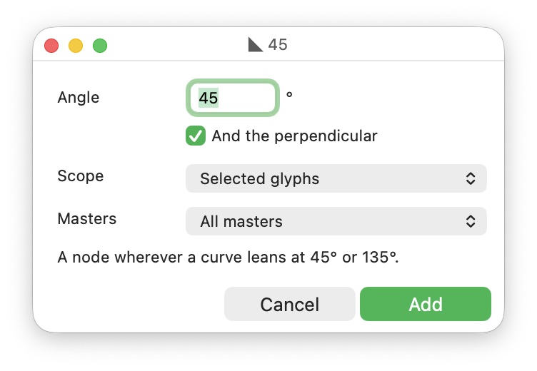

# ◣ 45°

By Giuseppe Salerno [rsztype.com](https://rsztype.com).

A [Glyphs](https://glyphsapp.com/) script that adds a node wherever a curve leans at 45°, the way Glyphs adds one at the extremes. A circle drawn on four nodes comes out with eight. Nothing moves: the outline stays exactly where it was.

### Options

- **Angle**: 45 by default, 0 gives the plain extremes, any other value the slant you want.
- **And the perpendicular**: adds the nodes at the opposite diagonal too.
- **Scope**: selected glyphs or the whole font.
- **Masters**: all masters, so they stay compatible, or the current one only.

### Usage

1. Put `45.py` in your Glyphs *Scripts* folder and choose *Script > Reload Scripts*.
2. Run **◣ 45°**, set the angle and press **Add**.

Glyphs 3 or 4.

### License

Copyright 2026 Giuseppe Salerno / Resistenza Type. Free to use, modify, and distribute, provided as-is.
