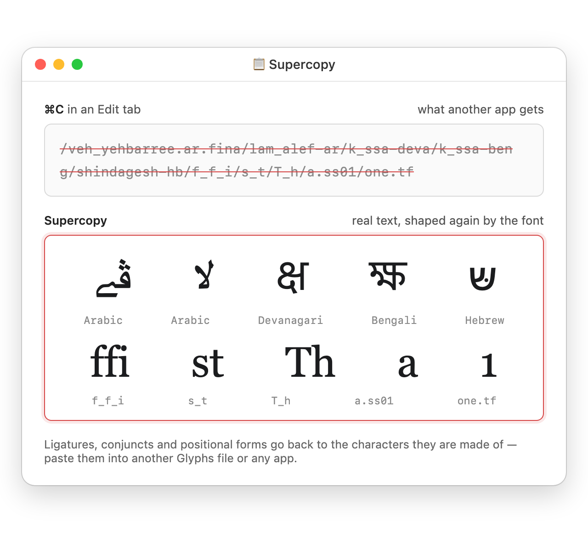

# 📋 Supercopy

By Giuseppe Salerno [rsztype.com](https://rsztype.com).

A [Glyphs](https://glyphsapp.com/) script that copies the selected glyphs as real text, not `/glyphnames`. Paste them into another Glyphs file or any app.

### Works with

- **Arabic**: `lam_alef-ar` → لا, `veh_yehbarree.ar.fina` → ڤے
- **Hebrew**: `shindagesh-hb` → שּ
- **Devanagari**: `k_ssa-deva` → क्ष
- **Bengali**: `k_ssa-beng` → ক্ষ
- **Latin**: `f_f_i` → ffi, `T_h` → Th, `a.ss01` → a, `one.tf` → 1

### Usage

1. Put `Supercopy.py` in your Glyphs *Scripts* folder and choose *Script > Reload Scripts*.
2. Select letters in an Edit tab or glyphs in the Font View.
3. Run **📋 Supercopy**, then ⌘V where you like.

Glyphs 3 or 4.

### License

Copyright 2026 Giuseppe Salerno / Resistenza Type. Free to use, modify, and distribute, provided as-is.
